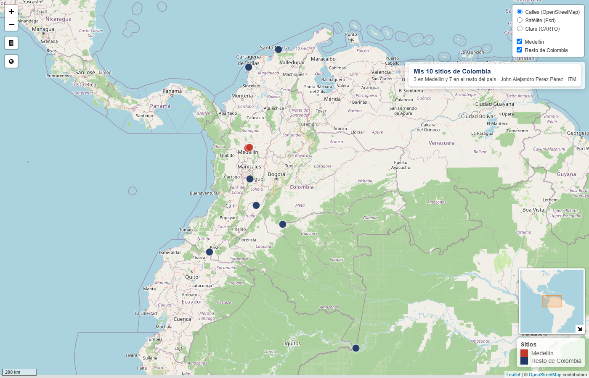

# Mis 10 sitios de Colombia: mapa interactivo con R

Mapa dinámico con 10 sitios de Colombia (3 en Medellín y 7 en el resto del país), hecho con R y los paquetes **sf** y **leaflet**.

**Ver el mapa:** https://pkrw6n5jgj-cyber.github.io/mapa-interactivo-colombia/



## Qué hay en el repositorio

- `mapa_interactivo.R`: script que crea los datos, los convierte en objeto espacial con `sf` (WGS 84, EPSG:4326), calcula la distancia de cada sitio al ITM y arma el mapa con `leaflet`.
- `index.html`: el mapa exportado con `htmlwidgets::saveWidget()`, autocontenido.

## Cómo reproducirlo

En RStudio o Posit Cloud:

```r
install.packages(c("sf", "leaflet", "htmlwidgets"))
source("mapa_interactivo.R")
```

Coordenadas consultadas en OpenStreetMap (Nominatim) el 28 de octubre de 2026. Mapas base: OpenStreetMap, Esri y CARTO.

John Alejandro Pérez Pérez · Ingeniería de la Calidad · Instituto Tecnológico Metropolitano (ITM) · XRREGEN02 Revolución Geoespacial: los nuevos mapas
